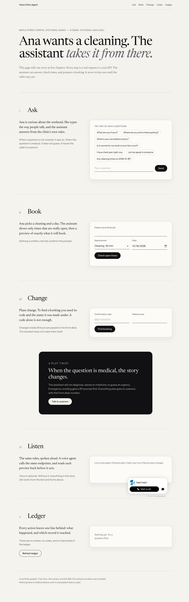
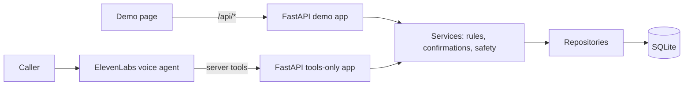

# Voice Clinic Agent

I built this to learn how a voice agent can book things without making things up.

The setup is a fictional dental clinic called Maple Street Dental. A caller talks to a voice agent, which I connected through ElevenLabs. The agent can answer questions, check open times, book, reschedule, and cancel. The part I cared about most is the part the agent doesn't control: a small FastAPI service that decides what is allowed to happen.


> Everything here is made up: the clinic, the names, the addresses, and the 555-01xx phone numbers. There is no real patient data, and nothing in this repo is medical advice.



---

## What I wanted to learn

Voice agents are good at conversation and bad at being strict. Ask one to book a slot and it will sometimes offer a time that doesn't exist, skip the "are you sure?" step, or send `3:30 PM` in a format your API has never seen. I wanted to find out what it takes to stop those things from doing damage, and whether the answer is in the prompt or in the code.

My answer, after this project: the code. The prompt helps the agent behave well, but the server has to be right even when the agent isn't.

## How it works

- **The agent** handles speech and conversation. It is a language model, and it is not part of the logic in this repo.
- **The backend** is ordinary code with tests. It works out open times, runs the preview-then-confirm step, enforces the 24-hour rule, checks the name and confirmation code, and decides what gets escalated.
- **The browser demo** has a text box. It answers with keyword rules, not a model, so the demo runs with no keys at all.

A booking goes like this. The agent asks for a time, the server returns a preview with a single-use token, the caller says yes, and only then does the server write. A flag in the request can't skip that step. I tested that on purpose, because it was the first thing I'd have broken by accident.

Here's the layout, from the outside in. Routes validate and call services. Services hold the rules and have no HTTP code. Repositories hold all the SQL. Pydantic checks everything at the edge. I kept the layers separate so I could test the rules without starting a web server.



The tools-only app exists for one reason: the tunnel that connects the agent to my laptop should only ever reach the tool routes. The demo app has an unauthenticated API and an activity log, so it stays on localhost.

## What broke, and what I changed

Most of what I learned came from the live calls. The first few failed, and the logs said why.

- **An empty token.** The agent sent `""` for an optional field it wasn't using. The server rejected it, so no preview was ever created. Now a blank value counts as missing.
- **Errors that didn't name the field.** The agent saw "invalid request" and told the caller there was a technical issue. The error now names the field and the format it expected.
- **Times and dates in every shape.** I started with a list of accepted formats. Every failed call used one I hadn't listed. The parser now reads the hour, minute, and AM/PM marker from anywhere in the text. It handles `3:30pm`, `half past three`, and `October 23rd`. The schema also describes the exact format to the agent, which turned out to matter more than the parser.
- **A retry that could book twice.** If a reply got lost, the page could resend and create a second booking. Now a retry returns the original. I also found a worse case: rebooking a slot after cancelling it showed a false success, because the old key still matched. The server refuses that replay now.
- **A stale screen after a change.** After a reschedule or cancel, the page kept showing the old state. It now re-reads the booking from the server.
- **Escalation messages that promised too much.** Some of my messages said a team member had been told. Nothing sends a notification in this project. Every message now says the demo records the request and notifies no one.

The full log, including the calls that failed, is in [`docs/LIVE_TESTING.md`](docs/LIVE_TESTING.md). I'd rather you read the mistakes than take my word for the result.

## Running it

You don't need any accounts or keys to try the demo.

```bash
cd backend
python3 -m venv .venv && . .venv/bin/activate
pip install -r requirements-dev.txt
uvicorn app.main:create_app --factory --host 127.0.0.1 --port 8000
```

Then open <http://127.0.0.1:8000>. The page walks through a made-up caller named Ana: she asks about hours, books, changes her booking, and then sees the ledger of what happened.

If you want the voice part, copy `.env.example` to `.env` and fill it in. The app doesn't read `.env` on its own, so load it into your shell first:

```bash
set -a; . ../.env; set +a
```

Setup for ElevenLabs is in [`docs/ELEVENLABS_SETUP.md`](docs/ELEVENLABS_SETUP.md). The agent instructions I wrote are in [`docs/AGENT_INSTRUCTIONS.md`](docs/AGENT_INSTRUCTIONS.md).

## Tests

```bash
cd backend
.venv/bin/pytest -q
.venv/bin/ruff check . ../scripts --config pyproject.toml
.venv/bin/ruff format --check . ../scripts --config pyproject.toml
```

Last run: 193 tests passed. 162 of them are unit and API tests. The other 31 are scenarios in [`evals/scenarios.json`](evals/scenarios.json), which run realistic conversations against the real app. How I wrote them is in [`evals/README.md`](evals/README.md).

There's one more check that isn't in pytest. [`scripts/live_check.py`](scripts/live_check.py) sends the same requests the agent sends, through a public URL, and then cleans up. It passed 12 of 12 on the last run. It only works while the tunnel is up.

## Where it stands

- The demo page works. I drove it in a browser through booking, rescheduling, cancelling, the 24-hour refusal, and the lost-reply recovery.
- The voice tools work through a tunnel from my laptop. One booking made by voice went through and was found afterwards in the browser. That was one call, not a series, so I wouldn't call it reliable yet.
- The agent instructions in `docs/AGENT_INSTRUCTIONS.md` are written. I haven't re-checked that the agent I configured follows them exactly.
- Escalations are recorded in the database. Nobody gets notified.

## What I'd still change

- **Lost replies on the voice path.** The browser can recover a lost confirmation because it keeps a request key. The voice path has no key. If the confirm reply gets lost, the agent can't tell whether the booking went through. The fix is probably to have the agent keep the confirmation code from the preview.
- **Finding a booking without the code.** Right now you need the code and the name. That's deliberate, since a name alone would let anyone look up anyone's booking. It's still annoying when someone has lost the code.
- **Hosting.** The tools run through a temporary tunnel, and the URL changes every time it restarts.
- **Real use.** I've only tested this with scripted and staged calls. I haven't had a real caller use it for a whole conversation.
- **Keyword safety checks.** They're enough for a demo. They aren't clinical triage, and I wouldn't ship them as they are.

## Project layout

```
backend/app/        routes, models (schemas and input parsing), services (rules), repositories (SQL), data (FAQ)
backend/tests/      unit, API, tools, retries, wording, and evaluation tests
evals/              evaluation scenarios and how they're run
frontend/           demo page
scripts/            live check against a public URL
docs/               setup, agent instructions, live log, case study, recording guide
```

If you're reading this to see how I think about the work, the most useful files are [`booking.py`](backend/app/services/booking.py), [`confirmations.py`](backend/app/services/confirmations.py), [`DECISIONS.md`](DECISIONS.md), and [`docs/LIVE_TESTING.md`](docs/LIVE_TESTING.md).
